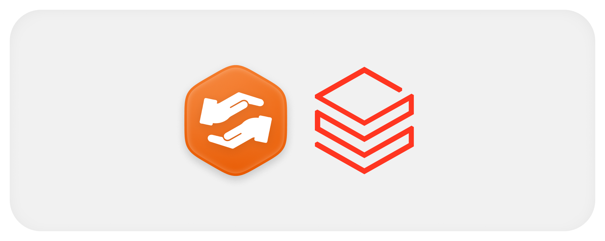
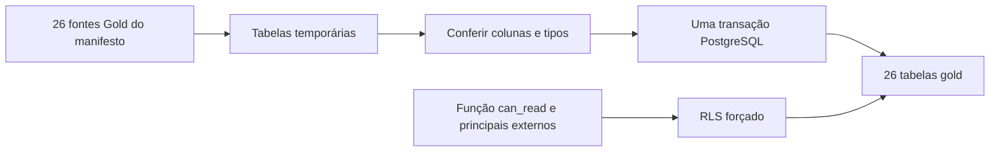

  

# Destino dos indicadores

O exportador cria tabelas homônimas aos indicadores do manifesto no schema `gold`. O schema base e a função `gold.can_read(text,text)` são pré-requisitos externos. Os campos são derivados por DESCRIBE e não estão fixados neste repositório.

## Objetos revisados

| Tabela | Escopo | Coluna exigida |
|---|---|---|
| `kpi_admin_registrations` | `ADMIN` | `sem identificador de entidade` |
| `kpi_admin_models_by_status` | `ADMIN` | `sem identificador de entidade` |
| `kpi_admin_proposals_by_status` | `ADMIN` | `sem identificador de entidade` |
| `kpi_supplier_offers_by_status` | `SUPPLIER` | `supplier_id` |
| `kpi_supplier_stock_by_model` | `SUPPLIER` | `supplier_id` |
| `kpi_supplier_offers_summary` | `SUPPLIER` | `supplier_id` |
| `kpi_supplier_offer_details` | `SUPPLIER` | `supplier_id` |
| `kpi_supplier_stock_summary` | `SUPPLIER` | `supplier_id` |
| `kpi_supplier_proposals_by_status` | `SUPPLIER` | `supplier_id` |
| `kpi_supplier_proposals_summary` | `SUPPLIER` | `supplier_id` |
| `kpi_supplier_accepted_value_by_model` | `SUPPLIER` | `supplier_id` |
| `kpi_supplier_accepted_value_by_month` | `SUPPLIER` | `supplier_id` |
| `kpi_supplier_accepted_offers_by_date` | `SUPPLIER` | `supplier_id` |
| `kpi_requester_summary` | `REQUESTER` | `requester_id` |
| `kpi_requester_proposals_by_status` | `REQUESTER` | `requester_id` |
| `kpi_requester_projects_by_status` | `REQUESTER` | `requester_id` |
| `kpi_professional_summary` | `PROFESSIONAL` | `technician_id` |
| `kpi_professional_services_by_status` | `PROFESSIONAL` | `technician_id` |
| `kpi_professional_reviews` | `PROFESSIONAL` | `technician_id` |
| `kpi_supplier_orders_summary` | `SUPPLIER` | `supplier_id` |
| `kpi_supplier_orders_by_status` | `SUPPLIER` | `supplier_id` |
| `kpi_supplier_sales_by_month` | `SUPPLIER` | `supplier_id` |
| `kpi_supplier_sales_by_model` | `SUPPLIER` | `supplier_id` |
| `kpi_supplier_subscription` | `SUPPLIER` | `supplier_id` |
| `kpi_admin_orders_by_status` | `ADMIN` | `sem identificador de entidade` |
| `kpi_admin_subscriptions_by_plan` | `ADMIN` | `sem identificador de entidade` |

O exportador não cria PK, FK nem índice de busca nessas tabelas, mas cria as colunas e os tipos, compara ordem e tipos com o destino existente e exige migração explícita quando há diferença.

## Escrita e leitura

A exportação obtém trava transacional, prepara staging, habilita e força RLS, recria a política `kpi_read`, limpa e repovoa cada destino na mesma transação. Falha desfaz o conjunto. Uma role leitora opcional recebe uso do schema, execução da função e SELECT, sem ser criada pelo exportador.

A RLS chama `can_read` com o escopo e o identificador da linha. O leitor compartilhado do api-core informa o contexto da requisição com `set_config('gold.scope', ...)` e `set_config('gold.entity_id', ...)` dentro de uma transação, e `can_read` só aceita esse contexto de um login cadastrado como `READER`. A tabela `gold.load_info` guarda a data da última carga. A função, e a função, os principais e os privilégios ficam provisionados no banco de analytics.

Os decimais preservam o Decimal exato e um tipo não reconhecido interrompe a carga, enquanto os timestamps com timezone sem essa informação no valor recebem UTC. O destino guarda apenas o resultado atual, sem um histórico de cargas próprio.

Fonte em [exportador](https://github.com/Solierrr/databricks-sync/blob/main/gold_synchronizer.py) e [manifesto](https://github.com/Solierrr/databricks-sync/blob/main/gold_export_manifest.json).
